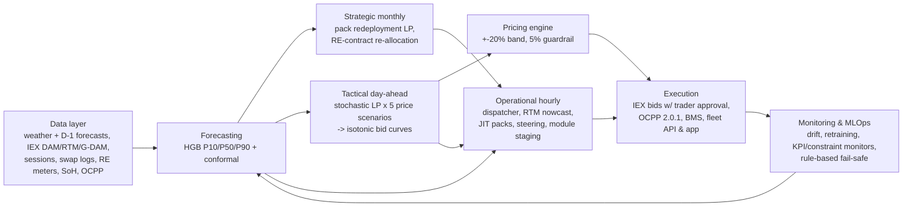

# EV Grid Intelligence

AI decision framework for real-time energy allocation, storage optimisation and dynamic bidding & pricing for a
1,200 MW / 600 MWh EV fast-charging + battery-swapping network in five Indian metro clusters (Delhi NCR, Mumbai MMR,
Bengaluru, Hyderabad, Chennai).

> **Data note.** Company data were not provided. All results come from a calibrated synthetic digital twin
> (5 years of hourly weather, IEX prices, RE generation, demand, swap logs and battery SoH). The baseline is calibrated
> to today's KPIs with structural parameters only and frozen (`config/calibrated.yaml`) before the AI policy runs on
> identical data, seeds and physics. Every number below is injected from `results/*.json` by `evgrid/reporting/build_report.py`.

## Results (FY2025-26 full year)

| Cluster | Reliability (target >= 89.7%) | Losses (target <= 8.0%) | EBITDA margin (target > 12%) |
|---|---|---|---|
| overall | 77.9% -> **88.9%** | 10.09% -> **7.14%** | 12.1% -> **19.5%** |
| DEL | 73.0% -> **87.2%** | 9.92% -> **6.69%** | 19.8% -> **28.3%** |
| MUM | 66.2% -> **82.2%** | 9.44% -> **6.93%** | 7.1% -> **18.2%** |
| BLR | 89.3% -> **93.9%** | 8.96% -> **6.79%** | 23.7% -> **26.2%** |
| HYD | 94.1% -> **97.2%** | 12.13% -> **8.34%** | -2.3% -> **2.5%** |
| CHE | 90.6% -> **96.6%** | 12.44% -> **8.49%** | -8.3% -> **0.6%** |

- Reliability target **missed** (88.9%); raising app/fleet steering acceptance by 25% closes the gap (90.7%).
- Loss target **met** (7.14%).
- EBITDA > 12% in all clusters **missed**: company 19.5%; the over-built surplus clusters
  need capacity re-siting / RE-contract re-allocation (quantified in the report, Section 9).
- Hard constraints (price band, guardrail, 5% reserves, grid limits) held in 100% of simulated hours; energy balance closes every hour.
- Programme economics: +INR 255 crore/yr EBITDA, payback 1.4 months, 5-yr NPV INR 891 crore at 12% WACC.

Full report: [reports/EV_Grid_Intelligence_Report.md](reports/EV_Grid_Intelligence_Report.md) (also `.html` / `.pdf`). Exam answer text: [ANSWER_BOX.md](ANSWER_BOX.md).

## Architecture



## Quickstart

```bash
pip install -r requirements.txt          # Python 3.9+; uses scipy HiGHS (no external solver)
python run_all.py --quick                # data -> forecasts -> calibration -> simulation -> analysis -> report
python run_all.py --full                 # full-year Baseline vs AI + all scenarios
python run_all.py --stage report         # rebuild report/README/ANSWER_BOX from results/*.json
python -m pytest -q                      # constraint, energy-balance, KPI and leakage tests
```

Stages cache to `results/cache/` (git-ignored) and resume on rerun; `--force` recomputes (recalibration overwrites the frozen
`config/calibrated.yaml`, so only use it deliberately).

## Repository map

| Path | Content |
|---|---|
| `config/base.yaml`, `scenarios.yaml`, `calibrated.yaml` | all parameters with unit + source; stress scenarios; frozen baseline calibration |
| `evgrid/data/` | synthetic digital twin (`synth.py`), real-data schema + adapter (`schema.py`), caching (`io.py`) |
| `evgrid/forecasting/` | leakage-safe features, pooled HGB + split-conformal intervals |
| `evgrid/optimization/` | sparse LP builder (HiGHS), day-ahead LP, bid curves, pricing, strategic redeployment LP, loss & degradation physics |
| `evgrid/simulation/` | rolling digital-twin engine, policies, KPIs, calibration, parallel runner |
| `evgrid/analysis/` | ablations, scenarios, Monte Carlo, sensitivity, Pareto, scalability, economics, figures |
| `evgrid/reporting/` | report / README / answer-box builder |
| `tests/` | pytest suite (price band, reserves, grid limit, energy balance, bid monotonicity, KPI maths, no leakage) |
| `data/` | `README.md` (schema & data dictionary), `sample/` 14-day extract |
| `results/` | KPI JSON outputs; `reports/` report + figures; `docs/` model formulation & assumptions |

## Using real data

Map operator extracts with `evgrid.data.schema.adapt_real_data(...)`, validate with `evgrid.data.schema.validate(df)`, write
`data/generated/hourly.parquet` (+ hubs, soh) and rerun `python run_all.py --full`. See [data/README.md](data/README.md).

MIT License.
