# EV Grid Intelligence - AI decision framework for a 1,200 MW EV charging & battery-swapping network

*Generated by `evgrid/reporting/build_report.py` from `results/*.json`. Simulation period: FY2025-26 full year. Data: calibrated synthetic digital twin (company data not provided). Repository: <https://github.com/GauravSRC/EV-Grid-Intelligence>.*

## 1. Executive summary

| KPI (FY2025-26) | Baseline (status quo) | AI framework | Target | Status |
|---|---|---|---|---|
| Service reliability R | 77.9% | 88.9% | >=89.7% | MISSED |
| Storage & conversion losses | 10.1% | 7.1% | <=8.0% | MET |
| EBITDA margin (company) | 12.1% | 19.5% | >12.0% | MET |
| EBITDA margin > 12% in all clusters | 2/5 | 3/5 | 5/5 | MISSED |

- **Reliability** rises from 77.9% to 88.9% (+11.0 pp); swap stock-outs fall from 17.1% to 0.01% and DC lost sessions from 23.5% to 13.7%. The remaining gap to 89.7% is DC hub saturation in Mumbai and Delhi; raising app/fleet steering acceptance by 25% (retail 25%, ride-hailing 62.5%, logistics 87.5%) closes it (90.7% on representative weeks).
- **Losses** fall from 10.09% to 7.14% of meter input (target met), mainly from charger module staging, just-in-time pack charging at lower C-rate and fewer idle charged packs.
- **EBITDA** rises from INR 294 crore (12.1%) to INR 550 crore (19.5%) after charging the AI run cost (INR 18 crore/yr) and pack transport. HYD, CHE remain below 12%: these are the deliberately over-built surplus clusters (low demand per MW, over-contracted RE). Operations alone cannot fix a capacity-allocation problem; re-siting 3 pp of installed capacity each from HYD/CHE to MUM/DEL lifts them to 14.1% / 11.4% (Section 9).
- **Economics**: incremental EBITDA INR 255 crore/yr vs INR 30 crore build -> payback 1.4 months, 5-year NPV at 12% WACC INR 891 crore.
- **Compliance**: price band, fleet band, daily guardrail, 5% reserves (chargers, packs, BESS) and sanctioned grid limits held in 100.0% of hours; hourly energy balance closes (max error 7.1e-14 MWh).

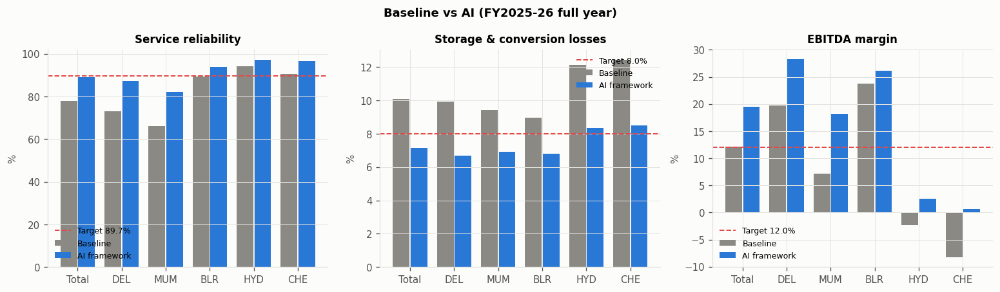

## 2. Problem framing and KPI definitions

The operator runs 1,200 MW (60% DC fast charging, 40% swap racks) and 600 MWh of storage (300 MWh stationary LFP BESS + 300 MWh swap-pack inventory) across Delhi NCR, Mumbai MMR, Bengaluru, Hyderabad and Chennai, buying ~35% of energy under solar/wind open-access contracts and the rest from DISCOMs and the IEX day-ahead market. Today hubs are mis-sized relative to where and when demand appears: queues and swap stock-outs in DEL/MUM/BLR coexist with idle chargers, idle packs and spilled RE in HYD/CHE.

- **Reliability R** = (DC kWh + swap kWh delivered) / reference demand over 24x7 operating hours. Reference demand is what customers would request at the reference tariff (the D-1 forecast target; identical denominator for both policies). Credit is capped at the reference volume per segment-day, so discount-induced demand cannot inflate R. Also reported: R_literal (vs the policy's own D-1 P50), DC lost-session % and swap stock-out %.
- **Loss %** = (charger conversion + standby, BESS round-trip + auxiliaries + self-discharge, pack charging, idle-pack self-discharge + BMS + cabinet cooling, transformer no-load + I2R) / meter input (DISCOM + net DAM + RTM + RE consumed). RE spill is reported separately.
- **EBITDA margin** = (revenue ex-GST - energy cost - variable opex - fixed opex) / revenue. Battery degradation is excluded from EBITDA and reported as an economic cost and as 'EBITDA after degradation'.

## 3. End-to-end architecture

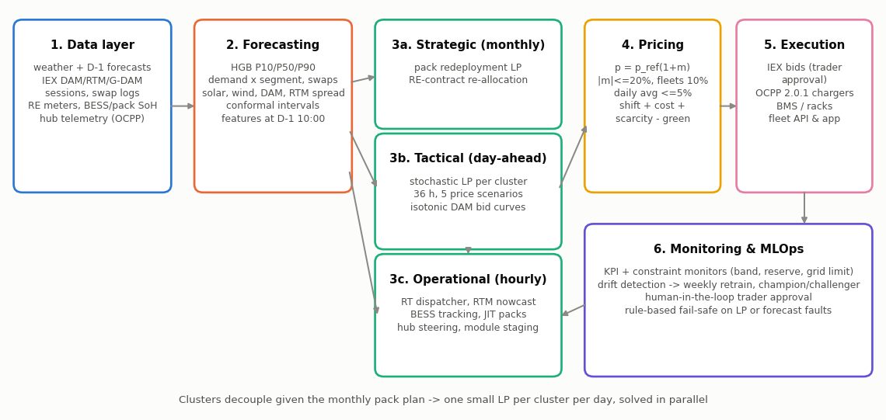

1. **Data layer** - weather actuals and D-1 forecasts, IEX DAM/RTM/G-DAM, charging sessions and swap logs (requested demand incl. lost), RE meter data, BESS/pack state of health, OCPP charger telemetry. A documented schema plus adapter (`evgrid/data/schema.py`) makes the pipeline data-agnostic.
2. **Forecasting** - pooled gradient-boosted models (scikit-learn HistGradientBoosting) for DC demand by cluster x segment, swaps by class, solar, wind, regional DAM price and the RTM-DAM spread, with split-conformal P10/P90 by series and hour band. Features are restricted to what is known at the IEX bidding window (D-1 10:00): calendar, festivals, weather forecasts, lags >= 48 h, rolling levels to D-2.
3. **Optimisation in three time scales** - strategic (monthly pack redeployment transport LP; annual RE-contract re-allocation advice), tactical (day-ahead stochastic LP per cluster over 36 h for 5 price scenarios -> isotonic DAM bid curves, BESS and pack plans, load-shift plan), operational (hourly dispatcher with actuals and a 1-h-ahead RTM nowcast, BESS tracking, just-in-time pack charging, hub steering, module staging).
4. **Pricing** - p = p_ref x (1 + m) with m built from the LP's shift plan, wholesale pass-through, scarcity and green-hour discounts; hard-clipped to +-20% of the previous day's average tariff (+-10% for fleet contracts) with a 5% daily-average guardrail.
5. **Execution** - IEX bid files (trader approval before 12:00 gate closure), OCPP 2.0.1 smart-charging profiles and module sleep, BMS/rack charge setpoints, fleet API and consumer app (steering offers, dynamic prices).
6. **Monitoring & MLOps** - KPI and constraint monitors, forecast drift detection with weekly retraining and champion/challenger evaluation, human-in-the-loop trader approval, and a rule-based fail-safe (the status-quo policy) if an LP or forecast fails.

## 4. Quantitative model

This document states the quantitative model behind the framework: the planning optimisation the AI policy
solves (the **model**) and the nonlinear physics the digital twin simulates (the **plant**). Code references are
given for each block.

### 1. Sets and indices

| Symbol | Meaning |
|---|---|
| $c \in \mathcal{C}$ | clusters {DEL, MUM, BLR, HYD, CHE} (decoupled given the monthly pack plan) |
| $h \in \mathcal{H}_c$ | hubs in cluster $c$ (12; archetypes CBD / residential / IT park / highway) |
| $t \in \{1..T\}$ | hourly steps, $T = 36$ (24 h operating day + 12 h look-ahead, receding) |
| $s \in \{retail, ride, logi\}$ | DC customer segments; $k \in \{2W, 3W\}$ swap classes |
| $\omega \in \{P10,P30,P50,P70,P90\}$ | DAM price scenarios |

### 2. Exogenous relationships (data layer, `evgrid/data/synth.py`)

- **Weather to RE supply.** Solar: $CF^{pv}_t = \min\{1,\; 1.3\,\tfrac{GHI^{cs}_t(1-0.75\,cloud_t^{3.4})}{1000}\,(1-0.004(T^{cell}_t-25))\,PR\}$ with clear-sky GHI from solar geometry and $T^{cell}=T+0.03\,GHI$.
  Wind: Weibull($k$=2) speed via a Gaussian copula with daily + hourly AR(1), power curve $CF^{w}=\mathrm{clip}\big(\tfrac{v^3-3^3}{12^3-3^3},0,1\big)$, zero above 25 m/s.
- **Weather to demand.** $D_{s,t} = \bar D_s\, g^{yr}_t\, \pi_s(hour, dow)\, \sigma_t\, F^{fest}_t\, (1+0.015\,(T_t-32)^+)\, \rho^{rain}_{s,t}\, e^{\epsilon_t}$, $\epsilon$ AR(1) ($\phi$=0.6, sd 0.08), growth 20%/yr.
- **Price formation.** $\lambda^{DAM}_t = \min\{10,\; L_{FY}\, S_t\, [1 + a^{eve}_t + a^{night}_t - d^{solar}_m\,\widetilde{GHI}_t]\,(1+0.035\,\Delta T_t)\,(1.9 \text{ in scarcity regimes})\,e^{\eta_t}\}$ re-scaled to IEX FY means; $\lambda^{RTM} = \lambda^{DAM} +$ evening-skewed spread; $\lambda^{G\text{-}DAM} = (0.72\text{-}0.95)\lambda^{DAM}$.
- **Hub spatial structure.** Hub demand shares $s_{h,t} \propto w_h\,\pi_{arch(h)}(t)$; capacity and pack shares $\kappa_h$ drawn independently (Dirichlet, concentrated by $\gamma$) - the source of simultaneous queues and idle assets.

### 3. Day-ahead stochastic scheduling LP (`evgrid/optimization/day_ahead.py`)

Solved per cluster and day, for each price scenario $\omega$ (5 LPs, ~600 variables each, HiGHS).

**Decision variables (per $t$, MWh):** DAM buy $x^{dam}_t$, DISCOM draw $x^{dis}_t$, RE used / sold-or-banked / spilled $r^{u}_t, r^{s}_t, r^{sp}_t$,
BESS charge/discharge/energy $b^{+}_t, b^{-}_t, e_t$, pack charging $q_t$ and charged-pack inventory $I_t$, DC served/unserved $y_t, u_t$,
swaps served/unserved $z_t, v_t$, deferred/recovered flexible demand $f^{-}_t, f^{+}_t$ and backlog $B_t$.

**Objective (maximise margin = minimise):**

$$
\min \sum_t \Big[(\lambda^{\omega}_t + \phi + OA)x^{dam}_t + \tau^{ToD}_t x^{dis}_t - \pi^{sell}_t r^{s}_t - p^{dc}_t y_t - p^{sw}_t z_t
 + VoLL\,(u_t + v_t) + c^{deg}_{B} b^{-}_t + c^{deg}_{P}\eta_P q_t + h^{B}(T_t)e_t + h^{P}(T_t) I_t + c^{shift} f^{-}_t \Big]
 - V^{term}(e_T + 1.2\,I_T)
$$

**Constraints:**

1. AC energy balance: $x^{dam}_t + x^{dis}_t + r^{u}_t + \eta_d b^{-}_t = b^{+}_t + y_t/\eta_{chg} + q_t + a_t$ (linearised charger efficiency; $a_t$ forecast auxiliaries incl. staged-module standby).
2. RE split: $r^{u}_t + r^{s}_t + r^{sp}_t = RE^{fc}_t$.
3. Sanctioned grid connection: $x^{dam}_t + x^{dis}_t \le G_c$.
4. BESS: $e_t = (1-\delta_B)e_{t-1} + \eta_c b^{+}_t - b^{-}_t$; $(SoC_{min} + 5\%)E \le e_t \le SoC_{max}E$; $b^{\pm}_t \le 0.5C \cdot E$.
5. Packs: $I_t = (1-\delta_P)I_{t-1} + \eta_P q_t - z_t$; $0.05\,Q \le I_t \le Q$; $q_t \le$ rack power; $z_t \le I_{t-1} - 0.05Q$ (swaps come from start-of-hour inventory above the reserve).
6. Swap demand: $z_t + v_t = SW^{fc}_t$.
7. DC demand with virtual-battery load shifting: $y_t + u_t + f^{-}_t - f^{+}_t = D^{fc}_t$; $y_t - f^{+}_t \le \Phi_t$ where
   $\Phi_t = \sum_h \min(D^{fc}_t s_{h,t}, 0.95\,Cap_h) + \min\{\rho\,E_t(1-\ell), F_t\}$ is the spatially servable volume (closed-form hub model with steering acceptance $\rho$);
   $f^{-}_t \le \sigma\,D^{fc}_t$, $f^{+}_t \le F^{free}_t$; $B_t = B_{t-1} + f^{-}_t - f^{+}_t$, $B_{23} = B_T = 0$.
8. Non-negativity and bounds.

Degradation enters linearly: throughput cost $c^{deg} = \frac{C^{rep}(1-\text{residual})}{EFC_{80}\cdot 0.8}$ (packs ~INR 1.9/kWh, BESS ~INR 1.1/kWh) and a temperature-scaled SoC-holding cost
$h(T) = \frac{0.02}{8760}\,2^{(T-25)/10}\cdot\frac{(1.5-1)}{0.5}\cdot\frac{C^{rep}(1-\text{residual})}{0.2}$ (calendar fade x2 per +10 degC, x1.5 near full SoC).

### 4. Bid curves and clearing (`evgrid/optimization/bidding.py`)

For each hour, the five scenario solutions $(\lambda^{\omega}_t, x^{dam,\omega}_t)$ are sorted by price and projected onto a
non-increasing step function by pool-adjacent-violators (isotonic) regression; prices are capped at INR 10/kWh. The realised
DAM price clears the first step whose price is at or above it; above the top step the P90 quantity is bid at the cap.

### 5. Pricing engine (`evgrid/optimization/pricing.py`)

$p_{s,t} = p^{ref}_{s,d}(1+m_{s,t})$, $p^{ref}_{s,d}$ = previous day's realised average tariff. $m_t = m^{shift}_t + m^{cost}_t + m^{scar}_t - m^{green}_t$,
de-meaned (shape only, no level ratchet) plus an anchor towards list price; then $|m| \le 20\%$ (fleet contracts $\le 10\%$), daily average
change $\le 5\%$ (iterated shift-and-clip). $m^{shift}$ inverts the behavioural response so the LP's defer/recover plan is induced.

### 6. Real-time dispatch and physics (`evgrid/simulation/engine.py`, `losses.py`, `degradation.py`)

Merit order each hour with actuals: RE, cleared DAM, BESS (track plan SoC +-2%, deeper only to avoid unserved or when RTM/DISCOM is expensive),
RTM or DISCOM within the grid limit, then curtail pack charging, then DC (unserved; 30% waits one hour). Surplus: cancel discharge, charge
BESS, resell DAM on RTM, sell RE on G-DAM or bank (8% in-kind, <= 30% of monthly DISCOM draw), else spill.

Hub service (closed form): $S_0 = \sum_h \min(D_h, Cap_h)$, $E = \sum_h (D_h - Cap_h)^+$, $F = \sum_h (Cap_h - D_h)^+$, recovered $= \min(\rho E(1-\ell), F)$; same for swaps on
charged inventory, plus intra-city vans (AI). Behaviour: own-price elasticity on the daily tariff level, shiftable share responding to intra-day deviations (noise $N(1,0.25)$).

Losses (plant, nonlinear): charger $P^{loss} = n_{on}P_0 + k_1P + k_2P^2/P_{rated}$ per hub; BESS $\eta(C)$, auxiliaries rising with temperature, self-discharge;
pack charging $\eta$ 0.93 at 0.5C to 0.90 at 1.5C; idle packs (self-discharge 2.5%/month, BMS 1 W/pack, cooling proportional to charged MWh x (T-25)+);
distribution = transformer no-load 0.25% of rating + load loss 1% x (P/P_rated)^2.

### 7. Strategic layer (`evgrid/optimization/strategic.py`)

Monthly transport LP: $\min \sum_{ij} c_{ij}x_{ij} + \pi\sum_j short_j$ s.t. $short_j \ge Q^{tgt}_j - (Q_j + \sum_i x_{ij} - \sum_k x_{jk})$,
$\sum_k x_{jk} \le (Q_j - 1.05\,Q^{tgt}_j)^+$, with $Q^{tgt}$ from last year's same-month swap volume x growth / 2.6 turns/day and move costs INR 40-150/pack.

### 8. KPI definitions (`evgrid/simulation/kpis.py`)

- Reliability $R = \sum_{c,d}\big[\sum_s \min(del_{s,d}, ref_{s,d}) + \min(del^{sw}_d, ref^{sw}_d)\big] / \sum ref$ (reference = demand at reference tariff; same denominator for both policies; induced demand cannot inflate R).
- Loss % = (charger conversion + standby + BESS + pack charging + idle packs + distribution) / meter input (DISCOM + DAM net + RTM + RE consumed).
- EBITDA margin = (revenue - energy cost - variable opex - fixed opex) / revenue (ex-GST); degradation reported separately.

## 5. Key assumptions (full table with sources: docs/assumptions.md)

| Area | Assumption | Source |
|---|---|---|
| Network | 1,200 MW (DEL 26%, MUM 24%, BLR 20%, HYD 15%, CHE 15%), DC/swap 60/40; 12 hubs per cluster | Case + assumption |
| Storage | BESS 300 MWh LFP @0.5C, RTE ~87%; packs 300 MWh (~120k packs) @<=1.5C | Case; SECI tenders (RTE>=85%) |
| Grid | Sanctioned connection 0.36-0.50 x nameplate; DISCOM EV tariffs DEL 4.5, MUM 8.5, BLR 5.5, HYD 6.0, CHE 7.0 INR/kWh; ToD 0.8/1.0/1.2 | SERC orders; assumption |
| Market | DAM FY26 mean 4.74 INR/kWh (FY24 5.24, FY25 4.47 anchors), cap 10; landed = price + 0.02 + OA 1.4 | IEX AR 2024-25 |
| RE | Solar CUF 20%, wind 31%; ~35% of energy; HYD/CHE over-contracted; landed INR 4.75/kWh take-or-pay | MNRE/NIWE; case |
| Customers | DC INR 20.0/17.5/16.5 per kWh (retail/ride/logistics); swaps INR 70 (2W) / 150 (3W) | Market ranges INR 15-25/kWh |
| Behaviour | Elasticity -0.3/-0.5/-0.6/-0.2; shiftable 5/25/40/10%; steering AI 20/50/70/40% vs 5%; 30% of unserved DC waits 1 h | Assumption |
| Losses | Charger P0 0.50% of module rating (calibrated), k1 0.0238; pack eta 0.93-0.90; transformer 0.25% no-load + 1% load | INL/ORNL; IEC 60076 |
| Degradation | LFP 4,500 (packs) / 6,000 (BESS) EFC to 80%; replacement INR 9,000 / 7,000 per kWh; calendar 2%/yr at 25 degC | BNEF 2025; assumption |
| Opex | Payments 2.5% + site host 9% of revenue + INR 10/swap; fixed INR 1,090 crore/yr (calibrated) | Assumption / calibration |

**Frozen calibration** (bisection on representative weeks, verified on the full year): `network.hub_misalloc_gamma` = 3.0312; `losses.charger_p0_frac` = 0.005; `losses.charger_k1` = 0.02375; `opex.fixed_opex_cr` = 1090.0. Full-year baseline check: R 77.9%, losses 10.09%, EBITDA 12.1% with MUM, HYD, CHE below 12%.

## 6. Data and forecasting results

Synthetic digital twin: 43,824 hours x 5 clusters (Apr-2021 to Mar-2026). FY26 reference demand: DC 1.103 TWh, swaps 0.270 TWh (125 million swap requests). DAM means by FY: FY22 4.48, FY23 5.99, FY24 5.33, FY25 4.56, FY26 4.74 INR/kWh; solar-hour DAM in surplus months 2.25; 1.9% of FY26 hours at the INR 10 cap.

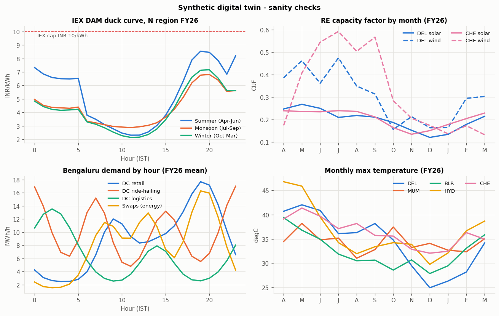

Test year FY26 (train FY22-FY25; conformal calibration on FY25):

| Target | WAPE ML | WAPE seasonal-naive | Pinball P50 (ML / naive) | P10-P90 coverage |
|---|---|---|---|---|
| dc | 0.077 | 0.100 | 323.7 / 420.7 | 80.0% |
| swaps | 0.062 | 0.088 | 44.25 / 62.38 | 81.8% |
| solar | 0.046 | 0.107 | 0.004593 / 0.01074 | 87.1% |
| wind | 0.310 | 1.052 | 0.04802 / 0.1632 | 78.7% |
| dam | 0.161 | 0.193 | 0.3805 / 0.4579 | 75.5% |
| spread | 0.984 | 1.341 | 0.2726 / 0.3715 | 78.1% |

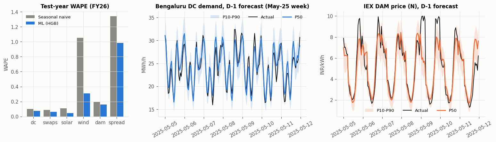

Coverage of the nominal 80% interval is 76-87%. Solar is easy here because the synthetic cloud forecast error is modest; real D-1 solar WAPE is typically higher, which the 'forecast errors x2' stress scenario covers.

## 7. Simulation results (Baseline vs AI on identical data, seeds and physics)

| Cluster | R base | R AI | Loss base | Loss AI | EBITDA base | EBITDA AI | EBITDA AI after degradation | Swap stock-out AI | DC lost AI |
|---|---|---|---|---|---|---|---|---|---|
| overall | 77.9% | 88.9% | 10.09% | 7.14% | 12.1% | 19.5% | 15.7% | 0.01% | 13.7% |
| DEL | 73.0% | 87.2% | 9.92% | 6.69% | 19.8% | 28.3% | 24.7% | 0.01% | 16.3% |
| MUM | 66.2% | 82.2% | 9.44% | 6.93% | 7.1% | 18.2% | 15.2% | 0.02% | 19.7% |
| BLR | 89.3% | 93.9% | 8.96% | 6.79% | 23.7% | 26.2% | 22.4% | 0.00% | 8.0% |
| HYD | 94.1% | 97.2% | 12.13% | 8.34% | -2.3% | 2.5% | -2.5% | 0.01% | 3.6% |
| CHE | 90.6% | 96.6% | 12.44% | 8.49% | -8.3% | 0.6% | -4.9% | 0.00% | 4.4% |

| Additional KPI (company) | Baseline | AI |
|---|---|---|
| Delivered energy (GWh) | 1,069 | 1,220 |
| Revenue (INR crore) | 2,436 | 2,821 |
| Energy cost (INR crore) | 668 | 714 |
| R_literal (vs own D-1 P50) | 78.2% | 88.4% |
| Induced minus suppressed demand (MWh) | 2,088 | -1,931 |
| RE consumed on site | 95.2% | 96.5% |
| RE monetised (consumed + sold + banked) | 95.2% | 100.0% |
| RE spilled (GWh) | 20.7 | 0.0 |
| Effective RE share of meter input | 34.2% | 31.4% |
| Average procurement cost (INR/kWh) | 5.62 | 5.43 |
| Peak grid import (MW) | 312 | 247 |
| BESS equivalent full cycles / yr | 287 | 289 |
| BESS SoH change (pp/yr) | -3.94 | -3.35 |
| Pack SoH change (pp/yr) | -6.85 | -6.96 |
| Pack turns / day | 2.04 | 2.46 |
| Economic degradation cost (INR crore) | 110 | 108 |

| Pack turns / day by cluster | DEL | MUM | BLR | HYD | CHE |
|---|---|---|---|---|---|
| Baseline | 2.53 | 2.04 | 3.47 | 1.26 | 1.13 |
| AI | 3.33 | 2.92 | 3.63 | 1.36 | 1.36 |

| Hard-constraint compliance (share of hours) | Baseline | AI |
|---|---|---|
| price band | 100.0% | 100.0% |
| fleet band | 100.0% | 100.0% |
| daily guardrail | 100.0% | 100.0% |
| grid limit | 100.0% | 100.0% |
| bess reserve | 100.0% | 100.0% |
| charger reserve | 100.0% | 100.0% |
| pack reserve | 100.0% | 100.0% |

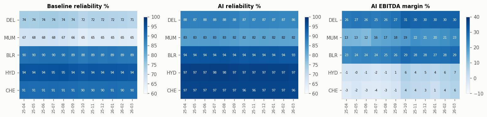

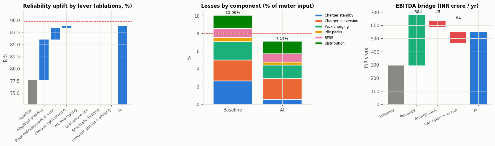

**Ablations** (AI minus one lever, 8 representative weeks annualised; contribution = AI - ablation):

| Lever removed | R | Loss % | EBITDA margin | Contribution to R | to loss | to EBITDA |
|---|---|---|---|---|---|---|
| ML forecasting | 88.8% | 7.20% | 19.8% | +0.00 pp | -0.04 pp | -0.05 pp |
| Stochastic bidding | 88.8% | 7.19% | 19.2% | +0.00 pp | -0.04 pp | +0.61 pp |
| Storage optimisation | 88.4% | 7.74% | 18.6% | +0.32 pp | -0.58 pp | +1.14 pp |
| Dynamic pricing & shifting | 89.0% | 7.06% | 20.0% | -0.22 pp | +0.09 pp | -0.25 pp |
| App/fleet steering | 80.9% | 7.55% | 17.0% | +7.86 pp | -0.40 pp | +2.83 pp |
| Pack redeployment & vans | 86.5% | 7.22% | 17.7% | +2.26 pp | -0.07 pp | +2.06 pp |
| Loss-aware ops | 88.8% | 8.78% | 20.4% | +0.00 pp | -1.63 pp | -0.59 pp |

Steering and pack redeployment carry most of the reliability gain, loss-aware operations and storage optimisation most of the loss reduction, stochastic bidding and storage optimisation most of the procurement saving. In this twin, dynamic pricing / load shifting is roughly neutral to slightly negative (behavioural noise and imperfect shift targeting offset its benefit), and selling/banking surplus RE inside the loss-aware lever slightly lowers EBITDA because banking credits are capped; both are reported as found.

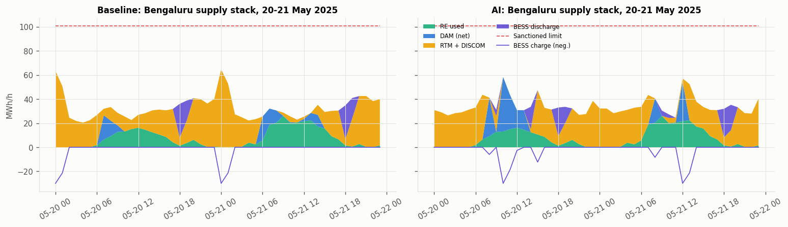

## 8. Scenarios and stress tests

| Scenario | R base | R AI | Loss AI | EBITDA base | EBITDA AI | Weakest cluster EBITDA (AI) |
|---|---|---|---|---|---|---|
| Heatwave (+4C, demand +12%, 3x cap-price hours, solar -5%) | 76.0% | 88.0% | 7.10% | 16.6% | 23.9% | CHE 6.7% |
| Weak-monsoon solar (-35%) | 77.7% | 88.8% | 7.15% | 12.7% | 20.2% | CHE 1.2% |
| Wind lull (-60%) | 77.7% | 88.8% | 7.15% | 12.4% | 19.7% | CHE 0.2% |
| Price shock (+40% DAM/RTM, capped) | 77.7% | 88.8% | 7.10% | 10.6% | 17.8% | CHE -1.4% |
| Demand growth +20% (next FY) | 75.0% | 87.5% | 6.85% | 19.0% | 26.0% | CHE 9.7% |
| Forecast errors x2 | 77.7% | 88.8% | 7.26% | 12.5% | 20.2% | CHE 1.2% |
| Battery ageing (SoH -10 pp) | 77.4% | 88.8% | 7.08% | 12.3% | 19.7% | CHE 0.3% |
| Grid derate -20% in Mumbai | 77.7% | 88.8% | 7.16% | 12.5% | 19.8% | CHE 0.4% |
| MoP ToD 0.7/1.3 | 77.7% | 88.8% | 7.35% | 12.4% | 20.3% | CHE 0.8% |
| Combined stress (heatwave + price shock + forecast x2 + ageing) | 75.8% | 88.1% | 7.60% | 14.6% | 22.8% | CHE 6.5% |

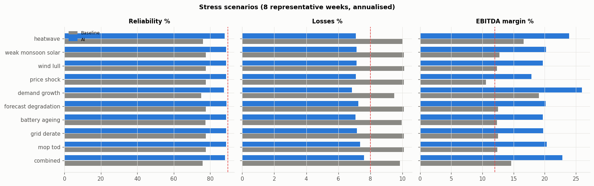

**EBITDA-at-risk** (20 Monte Carlo DAM/RTM/G-DAM price paths with AR(1) daily level shocks, one week per season): company P5 margin AI 18.3% vs baseline 11.3%; per-cluster P5 (AI): DEL 29.0%, MUM 13.2%, BLR 26.3%, HYD 3.3%, CHE -1.9%.

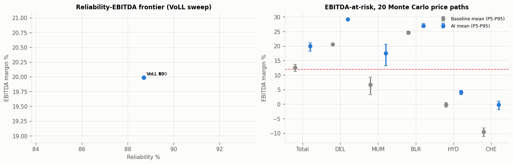

## 9. Scalability and economic feasibility

- One day-ahead LP (36 h, ~610 variables) solves in 11 ms with HiGHS using 0.3 MB; solve time grows with horizon length with exponent 0.89 (96 fifteen-minute blocks + look-ahead: 31 ms, 1.1 MB).
- Clusters decouple, so compute is linear in nodes (exponent 0.97): 100 cloned clusters x 5 price scenarios take 5 s on one core - 1467x inside the 2-hour IEX DAM bidding window and well inside the 30-min RTM cadence; hub-level steering is closed-form (4.1 microseconds per cluster-hour at 200 hubs).

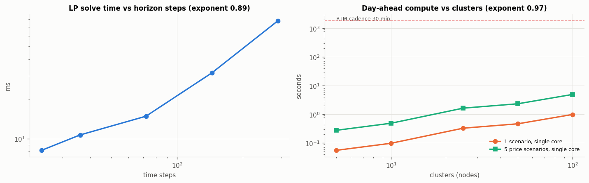

- **Programme economics**: AI build INR 30 crore + run INR 18 crore/yr (run cost already inside AI EBITDA). Incremental EBITDA INR 255 crore/yr -> payback 1.4 months; 5-yr NPV @ 12%: INR 891 crore (flat) / INR 1,285 crore (benefit growing 20%/yr).
- **+20% demand (next FY)**: AI-vs-baseline EBITDA gap INR 335 crore/yr (representative weeks); **2x network**: clusters decouple, so benefits (~INR 511 crore/yr) and compute scale linearly.
- **Marginal +100 MWh BESS**: INR 7.3 crore/yr EBITDA and -0.01 pp reliability vs an annualised capex of INR 28.3 crore/yr (INR 160 crore, 10 yr @ 12%) and an Indian standalone-BESS auction benchmark of INR 9.0-21.6 crore/yr for 50 MW. Not justified on EBITDA alone at current prices: contract BESS capacity rather than own it.

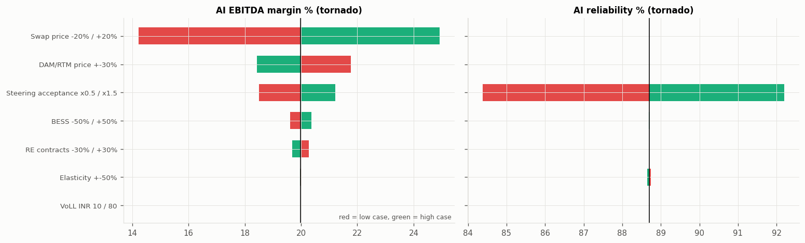

**What closes the remaining gaps** (AI + one additional lever, 8 representative weeks annualised):

| Lever | R | EBITDA | MUM EBITDA | HYD EBITDA | CHE EBITDA |
|---|---|---|---|---|---|
| AI (reference, representative weeks) | 88.8% | 19.8% | 18.0% | 3.4% | 0.4% |
| Steering acceptance x1.25 | 90.7% | 20.5% | 19.4% | 3.6% | 0.6% |
| Steering acceptance x1.5 | 92.2% | 21.0% | 20.3% | 3.7% | 0.8% |
| +100 MWh BESS | 88.7% | 20.0% | 18.4% | 3.7% | 0.9% |
| RE contracts re-allocated from HYD/CHE to DEL/MUM | 88.8% | 19.7% | 17.6% | 3.9% | 1.1% |
| Higher flexible fleet share | 88.7% | 19.7% | 17.9% | 3.3% | 0.2% |
| Re-site 3 pp capacity each from HYD/CHE to MUM/DEL | 89.2% | 20.0% | 14.0% | 14.1% | 11.4% |

Required EBITDA uplift to reach 12% in the full-year AI run: HYD INR 28 crore/yr, CHE INR 34 crore/yr. These clusters have a structural capacity/contract surplus; the levers that close it are asset re-siting (or selling surplus capacity to fleets as dedicated depots) and RE-contract re-allocation at renewal, not dispatch.

## 10. Roadmap, governance, risks and regulatory compliance

- **Q1 - pilot (Mumbai MMR)**: worst reliability and EBITDA among demand clusters; deploy forecasting + day-ahead LP in shadow mode for 4 weeks (trader compares bids), then live bidding with trader approval; OCPP module staging on 2 hubs; fleet-API steering with 2 ride-hailing partners.
- **Q2 - scale to all 5 clusters**: monthly pack redeployment and intra-city vans, dynamic pricing within the regulatory band, RE sale/banking desk; re-siting business case for HYD/CHE capacity; RE-contract re-allocation at the next renewal window.
- **Governance**: model risk register, champion/challenger forecasts, weekly retraining with drift alarms, monthly KPI review; trader sign-off on every DAM bid; automatic fall-back to the rule-based policy on solver/forecast failure; audit log of price changes.
- **Risks**: forecast drift after network expansion (mitigation: hierarchical retraining), price spikes (bid caps, EBITDA-at-risk limits), fleet partner adoption of steering (contractual incentives), battery ageing (degradation cost in the objective), cyber/OCPP security (signed firmware, segmented networks).
- **Regulatory**: CERC/IEX price cap INR 10/kWh respected in every bid; MoP EV charging guidelines 2024 (single-part tariff, ToD); state open-access and Green Energy OA banking rules; customer tariffs within +-20% of the previous-day average (hard-coded and unit-tested); 5% capacity, pack and BESS reserve for priority fleets/emergency services.

## 11. Limitations and next steps

- All data are synthetic; the calibration matches today's KPIs with structural parameters, but magnitudes of individual levers depend on the assumed behaviour (elasticities, steering acceptance) and hub misallocation. The pipeline is ready for real data via `evgrid/data/schema.py`.
- Hourly resolution (IEX 15-min blocks aggregated); the LP is linear (efficiencies, degradation linearised) while the simulator is nonlinear.
- Hub steering uses a closed-form aggregate (no explicit travel times or queues); swap stock-outs fall to near zero once packs follow demand, which may be optimistic.
- The operator is modelled as a price-taker; transmission congestion and DSM penalties are not modelled; pack transfers ignore 1-3 day transit.
- Next steps: queueing model per hub, reinforcement-learning dispatcher benchmarked against the LP, 15-min execution, and a hub-siting MILP.
